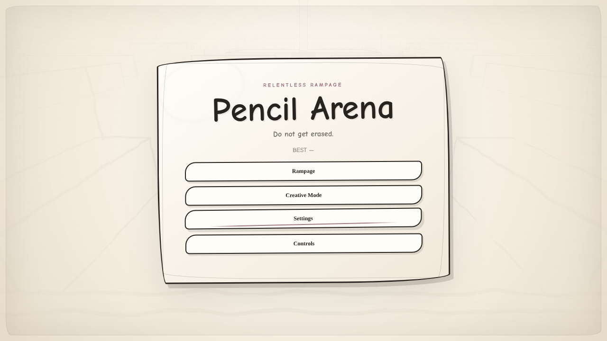

# Pencil Arena

A third-person stickman survival shooter in a hand-drawn 3D world, with enemy waves, procedural encounters, combat, traversal, camera solving and adaptive rendering.

**[Play on itch.io](https://abprojects.itch.io/pencil-arena)** · [Technical report](docs/TECHNICAL_REPORT.pdf) · [Report source](docs/TECHNICAL_REPORT.md) · [Architecture](docs/ARCHITECTURE.png)

## Run

Open **`index.html`** in a modern desktop browser with WebGL support. The runtime is a single-file HTML5 build: bundled scripts, styles and assets stay embedded. The game can also be uploaded as an HTML5 ZIP to itch.io with `index.html` at the root.

## Gameplay and controls

Keyboard and mouse control movement, aiming and firing; additional touch controls and gameplay settings are included in the HTML build.

## Repository guide

- `index.html`: complete executable game. Do not separate or import runtime dependencies.
- `docs/TECHNICAL_REPORT.pdf`: formal report covering architecture, algorithms, behavior changes and limits.
- `docs/TECHNICAL_REPORT.md`: readable report source for GitHub.
- `docs/ARCHITECTURE.png`: diagram of major subsystems.
- `docs/RELEASE_NOTES.md`: precise change summary.
- `docs/VALIDATION.md`: structured manual acceptance checks.
- `docs/RELEASE_MANIFEST.json`: original and release SHA-256 hashes.
- `tests/verify.mjs`: non-graphics regression and syntax smoke checks.

## Verification and performance

The updated build passed JavaScript syntax and document-integrity checks. An Xvfb-hosted Chromium session initialized WebGL and checked the visible menus. The intro completed and the Rampage/Creative menu appeared. Render-submission scheduling was examined with the WebGL draw method stubbed; **no measured FPS or GPU speedup is claimed**. See the report for details and `docs/VALIDATION.md` for the essential browser tests before publishing to itch.io.

## Source, screenshots and permissions

The existing game page is [Pencil Arena on itch.io](https://abprojects.itch.io/pencil-arena). The included cover screenshot was captured from this game in a software-WebGL browser. The itch.io page can supply additional screenshots once their exact image files are downloaded or verified. Third-party embedded engine licences remain with their original code. This repository does not include a new project licence; discuss licence terms before distributing for reuse.
