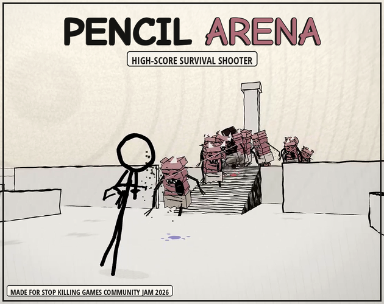
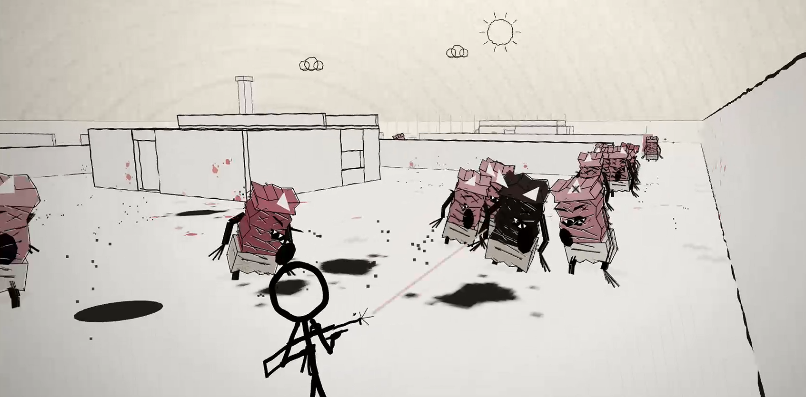
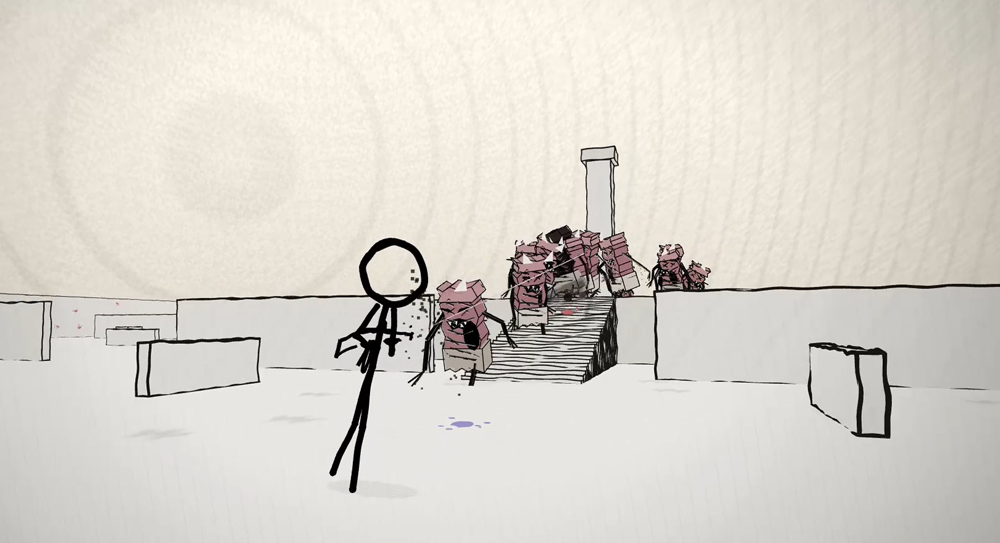
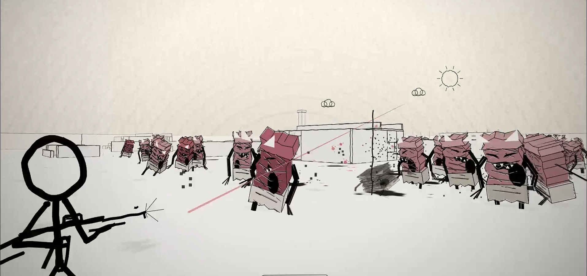
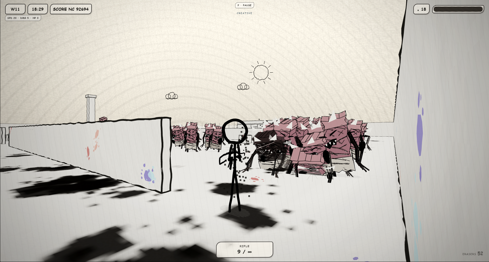
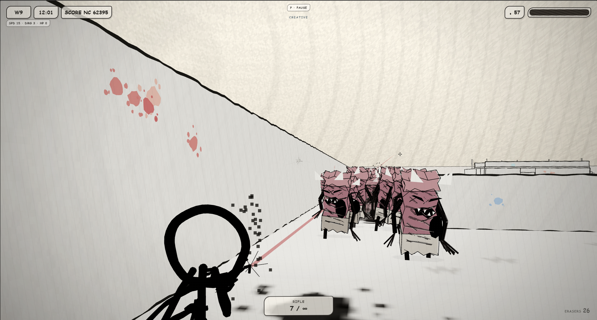

# Pencil Arena

A hand-drawn third-person survival shooter where a lone stickman fights increasingly large waves of hostile erasers in a sketchbook-style 3D arena.

**Links:** [Play on itch.io](https://abprojects.itch.io/pencil-arena) · [Technical report (PDF)](docs/TECHNICAL_REPORT.pdf) · [Technical report (Markdown)](docs/TECHNICAL_REPORT.md) · [Architecture diagram](docs/ARCHITECTURE.png)

## Gallery

Original images from the [official itch.io game page](https://abprojects.itch.io/pencil-arena):

## What the game contains

- **Endless survival loop:** stay alive, fight erasers, and push for a higher score.
- **Third-person combat:** movement, aiming, firing, and arena navigation.
- **Adaptive presentation:** camera solving, menu flow, and resolution scaling within a single-file browser build.
- **Jam-origin design:** built around direct, readable action rather than heavy progression systems.
- **Self-contained distribution:** the playable build remains one `index.html` with its code and assets embedded.

## Controls

Keyboard and mouse handle movement, aiming, and firing. The shipped build also includes touch-oriented affordances and gameplay settings in the HTML runtime.

## Run locally

Open **`index.html`** in a modern desktop browser with WebGL support. The same file can be uploaded to itch.io as an HTML5 project with `index.html` at the ZIP root.

## Repository contents

- `index.html` — the entire playable game.
- `docs/TECHNICAL_REPORT.pdf` — formal engineering report.
- `docs/TECHNICAL_REPORT.md` — GitHub-readable source of the report.
- `docs/ARCHITECTURE.png` / `docs/ARCHITECTURE.dot` — subsystem diagram.
- `docs/itch-gallery/` — the original itch.io gallery, with image-source records.
- `docs/RELEASE_NOTES.md` — exact change summary for this maintenance pass.
- `docs/VALIDATION.md` — browser acceptance checklist.
- `docs/RELEASE_MANIFEST.json` — source/release hashes and release metadata.
- `tests/verify.mjs` — self-contained packaging and syntax smoke checks.

## Maintenance changes in this release

This pass keeps the game structurally intact and does **not** split it into modules. The principal code change is an **idle-render governor**: hidden tabs skip rendering and non-simulation views render at most 10 times per second. Combat systems, enemy behavior, movement, camera logic, and core gameplay parameters remain on their original path.

## Verification status

- JavaScript syntax and packaging checks pass.
- A WebGL-capable Chromium session reached the intro and gameplay menu states without uncaught JavaScript errors.
- Manual browser playtesting is still required before any production republish.

## Notes on visuals and ownership

The images in `docs/itch-gallery/` were downloaded from the official itch.io game page; their exact source URLs and SHA-256 checksums are in `docs/ITCH_GALLERY_SOURCES.json`. No fabricated marketing images were created. Third-party embedded engine/runtime notices remain in the shipped source. No additional repository-wide licence has been selected here.
