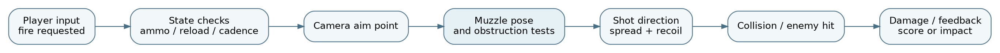

# Pencil Arena: Combat, Navigation, and Rendering in a Browser Shooter

**ABProjects · System Design and Implementation Report · October 2026**

## Abstract

**Pencil Arena** is a third-person, single-player survival shooter built as one self-contained HTML5/WebGL document. The player navigates a drawn three-dimensional arena and survives waves of hostile erasers using firearms, melee actions, movement and spatial awareness. The runtime includes authored arena geometry, player locomotion and postures, weapon state and shot resolution, enemy spawning and decision logic, collision and line-of-sight queries, third-person camera and muzzle validation, presentation effects, a wave/upgrade system, and adaptive display resolution. This report documents these systems as implemented, emphasizing the distinction between game rules, spatial queries, rendering and user-facing state. It analyzes why collision-aware camera and muzzle placement are correctness problems rather than cosmetic adjustments, why enemy decisions must be budgeted, and why frame-time feedback must be separated from simulation. A targeted maintenance revision reduces 3D draws when gameplay is inactive or the document is hidden without changing movement, combat, enemy decisions or weapon parameters. Available verification consists of static source inspection, parser checks, and limited Chromium/WebGL startup and UI observations. The report explicitly does not claim an active-play FPS improvement, a completed combat playthrough, or an exhaustive AI correctness result.

**Index terms—** third-person shooter; WebGL; game AI; spatial queries; camera collision; adaptive resolution; frame scheduling; single-file HTML5 game.

## I. Introduction

Pencil Arena places a stick-figure player against increasingly large groups of erasers in a stylized sketchbook world. The design is that of an arcade survival shooter: a short, repeatable combat loop with immediate aiming, movement and score feedback. The title originated in a community game-jam context, but the delivered runtime includes substantial systems beyond its premise: configurable controls, multiple weapons, hit resolution, traversal, wave staging, score and upgrades, feedback effects, adaptive display scaling and camera handling.

A third-person shooter introduces a special engineering challenge. The camera is displaced from the avatar, while the weapon's muzzle is displaced from both. A target visible to the camera may be blocked from the muzzle; a camera that tracks the desired target point may intersect a wall; a collision capsule may fit through a space that the visible weapon or camera does not. These are not isolated visual defects. They affect the player's understanding of shot direction and the fairness of hits. The implementation therefore contains several independently managed spatial-validation paths for movement, view positioning and weapon firing.

The other major challenge is cost control. Enemies need navigation goals, sensing and attack decisions. The renderer draws a stylized 3D scene at potentially high display resolution. Checking every possible obstruction at full precision on every frame would compete with rendering, while making decisions too rarely would cause unresponsive enemies. This report traces the architectural boundaries, the relevant numerical and state decisions, and the validation evidence without treating a source-wide refactor as necessary for a self-contained release.

## II. Runtime organization

### A. Single-document application

The game is packaged in one `index.html` containing authored HTML and CSS, game/application logic, and an embedded Three.js graphics runtime. No runtime import graph is needed to open the released file. Internally, the file still contains substantial conceptual subsystems: application state and menus, input mapping, simulation, enemy controller, weapons, camera and character presentation, world construction, WebGL renderer, and diagnostics. Bundling does not erase those boundaries; it merely places them in one distribution artifact.

The game state controller coordinates menu/intro, preparation, active wave, creative and terminal states. A wave starts only after the appropriate setup; a death changes the permitted actions and score/overlay state. Keyboard or mouse signals are interpreted against the current game state, so firing while a menu is open is not semantically equivalent to firing during a wave. Controls can also be remapped or configured through persistent settings.

### B. Main loop ownership

A single main loop collects a clamped frame interval, updates allowed world systems, updates camera and effects, and renders the scene if a frame should be displayed. Not every subsystem should act in every state. Enemy decision logic should not continue a fight during a paused menu, while the menu's DOM events should still be responsive. The revision under examination leaves input and state advancement in their original positions and gates only 3D draw submissions in non-simulation states.

This is a distinction between three quantities: the number of browser animation callbacks, the number of gameplay simulation updates, and the number of renderer submissions. They may be equal during active play, but need not be equal while the UI shows a static scene. Reducing render submissions is only one kind of optimization; the program still performs other work unless that work is separately gated by the game state.

## III. Player and world simulation

### A. Authored geometry and collision

The game builds a known arena rather than relying on continuously regenerated arbitrary world geometry. The source declares `AUTHORED_ARENA=true` and a seeded generator for *visual noise*, documenting that the cosmetic seed is not intended to change the navigable geometry. This distinction is valuable when investigating an enemy stuck in a corridor: cosmetic randomness should not silently change the collision map or navigation graph.

Player movement must account for horizontal displacement, floor support, stairs or climbs, crouching, sliding and interaction with solid geometry. Crouch-related state is not a single boolean: the source distinguishes manual crouch, forced crouch and slide-driven crouch, alongside posture and camera/weapon adjustments. Those flags need a consistent lifecycle. A short collision clearance can prohibit standing up even after the player releases the crouch key, while slide recovery must not override an unrelated ceiling constraint.

The world model couples these decisions to camera and muzzle configuration. When collision changes a posture or interrupts movement, the graphics and aiming pose must eventually converge on the new state without allowing an invisible old pose to fire for several frames. Consequently, movement-state transitions are important test points, not merely animation moments.

### B. Input, movement and aiming

Keyboard input controls locomotion and actions; mouse movement controls the desired view/aim. The program contains control sensitivities for ordinary aim and scoped aim, an invert-Y choice, field of view and camera distance. Settings are loaded defensively from browser storage, parsed and clamped into finite allowed ranges. This protects the simulation from invalid stored numbers or strings and prevents a corrupted preference from producing an unusable camera speed.

The camera attempts to maintain a third-person viewpoint under movement and nearby obstacles. Its requested position is a *proposal*, not an unconditional final pose; collision queries may push the camera nearer to the player or cause a different shoulder/offset selection. Smoothing then converts the chosen safe target into visual motion. A good camera solver must balance four conflicting requirements: keep the player visible, preserve intended aim direction, avoid geometry penetration, and limit abrupt jitter at obstacles.

## IV. Weapon and combat model

### A. Weapon state

Pencil Arena defines multiple weapon profiles rather than one generic projectile. The authored data includes properties such as magazine capacity, reserve ammunition, firing interval or rounds per minute, reload duration, damage, range, recoil, aim field of view and separate spread components for different stances. For example, a pistol profile in the inspected source specifies a 12-round magazine, 360 RPM, a 1.05-second reload, damage 34 and a nominal range of 150 game units. These are authored gameplay values, not real-world ballistics.

A weapon controller must coordinate trigger state, time until next shot, reload staging, current ammo, recoil recovery and optional scoped transitions. A reload should not create ammunition or permit a second firing branch to consume an already-fired round. A long browser frame should not blindly emit an arbitrary burst of overdue shots. The implementation tracks state including shot serial, reload time, fire pose, recoil and spread heat, making the firing sequence explicitly dependent on the runtime's temporal state.

### B. Spread and hit resolution

The source distinguishes hip, aimed, moving, airborne and heat-related spread. Conceptually, dispersion grows with instability: motion, airborne posture and successive firing add uncertainty, while aim mode reduces baseline dispersion. The resulting shot ray or projectile direction is then tested against environmental and actor collision. Damage and hit feedback follow the resolved outcome, not merely the camera crosshair position.

Crucially, the camera's aim ray and the physical muzzle ray are not necessarily identical in third person. Suppose the camera sees a target through an opening but the player's weapon barrel is adjacent to a wall. Firing straight along the camera ray could appear to pass through the wall. The muzzle pipeline must check a safe muzzle pose and whether the chosen shot trajectory is unobstructed from that pose. The runtime contains dedicated state for blocked and clear confirmations, reach errors, solve reasons and shot validation, as well as debugging counts for candidates, detailed tests and ray checks.

### C. Muzzle-safety and camera-cost reasoning

Let $\mathbf c$ be the camera position, $\mathbf m$ the muzzle position, and $\mathbf q$ the intended camera-ray aim point. A shot direction computed only from $\mathbf c$ is

$$
\widehat{\mathbf d}_{c}=\frac{\mathbf q-\mathbf c}{\|\mathbf q-\mathbf c\|},
$$

but the physically relevant direction begins at $\mathbf m$:

$$
\widehat{\mathbf d}_{m}=\frac{\mathbf q-\mathbf m}{\|\mathbf q-\mathbf m\|}.
$$

A valid shot should use the latter direction with an obstruction test from the muzzle, where required by the weapon model. This derivation explains the source's separate camera and muzzle validation concepts; it is not a claim that every weapon branch uses a single identical ray routine.

The solver can avoid repeating expensive geometry tests when the camera, posture, weapon and nearby environment have not changed enough to invalidate cached results. The inspected source includes a `cached` diagnostic and reason codes for invalidation. Caching needs careful invalidation: an obstructing object or moving avatar can invalidate what was previously a safe line. The code's debug statistics are important because a visually correct camera may still expend an excessive per-frame budget.

## V. Enemy, wave and progression systems

### A. Enemy sensing and decisions

Enemy behavior includes searching, investigating and pursuing/attacking. The source uses line-of-sight tests from an enemy eye point toward the player's relevant standing or crouched target height. Noise events also affect enemy decisions: gunfire or player movement can provide a stimulus even when a target is not currently visible. Maintaining separate sensory signals allows behavior to degrade gracefully from direct pursuit into last-known-position investigation rather than instantly forgetting the player.

A full enemy update involves multiple costs. Broad spatial selection identifies plausible nearby targets or navigation points; more expensive rays and local steering operate only on relevant candidates. Cost in a large wave is therefore not just $O(n)$ movement updates, where $n$ is living enemy count: sight checks, obstacle probes and path searches can dominate if performed indiscriminately. The program contains controls and instrumentation for these operations, but an actual per-wave CPU profile would be needed before claiming their efficiency is optimal.

### B. Wave and resource state

The `Rampage` controller manages preparation, wave progression, spawns, scoring and terminal outcomes. It also supports collected `ink`, crafting/health refills and upgrade purchases. Upgrade categories in the inspected code include speed, damage and health, with level-dependent costs and gameplay effects. These systems are coupled to combat decisions because ammunition, health and movement upgrades alter survival probability.

Two invariants protect this progression loop. First, an enemy kill should be counted at most once and lead to a consistent score/loot transition. Second, purchases should be atomic from the player's point of view: an upgrade must not apply unless the resource cost is successfully deducted. On game-over or new-run transitions, session upgrades, inventory, enemy counters and wave phases must reset in a defined order. Persistent high scores are separate from ephemeral run resources.

### C. Sensing schedules and worst-case enemy cost

An enemy is not merely a moving mesh. It has a goal, a behavioral mode, sensory updates, a target estimate, locomotion constraints and one or more attack opportunities. In a wave of $n$ living enemies, at least $O(n)$ work is required just to advance individual kinematic state once. If every enemy also casts a sight ray toward every interesting object, naive costs can grow toward $O(nm)$ with $m$ candidate targets and obstacles, before rendering. Path replanning adds a cost tied to the number of navigation graph nodes and edges. Even if each individual query is quick, synchronized replanning at wave spawn can create a frame spike.

The implementation avoids reducing enemy AI to a single universal distance check. `lineOfSight` examines a ray between an enemy eye and a target point affected by the player's stance; noises and assigned search targets contribute separate signals. This produces a more informative decision state than direct visibility alone. It also means incorrect caching is dangerous: a previous positive sight result may become false when the player crouches behind cover, and a noise-driven investigation should not be interpreted as confirmed line of sight. A sensible test should record mode transitions when the player fires behind a wall, crosses a corner, hides, and re-enters view.

A profile should report the living-enemy count alongside aggregate and tail latencies for AI update, sight tests and navigation. Without that context a single “60 FPS” observation conceals the actual scalability boundary. The shipped debug instrumentation already exposes part of this information; a more systematic benchmark can reuse that instrumentation before changing any of the underlying AI algorithms.

### D. State lifetimes and safe caching

Performance shortcuts are correct only while their assumptions remain true. Camera and muzzle calculations may reuse a previous solution when weapon, posture, aim and nearby world geometry have not changed. A cached safe pose becomes unsafe after a large player displacement, a shoulder change or a newly encountered obstacle. The source includes dirty/invalidation state and diagnostic reasons associated with pose solving; those checks deserve direct boundary tests rather than being treated as cosmetic cache hits.

Similarly, the game accumulates temporary objects: enemy instances, projectiles or hit effects, wave resources and HUD notifications. A resource leak during a two-minute playtest may be invisible but become severe after many waves. The useful invariant is that each temporary world resource has a defined owner and a cleanup moment after death, impact, expiry or run reset. Profiling heap growth after repeated preparation/wave/game-over cycles will distinguish intentional longer-lived caches from leaked references. This report does not claim such a long-duration heap test was already completed.

## VI. Rendering and resource management

### A. Third-person presentation

The runtime renders the player, erasers, arena geometry, lighting and sketch effects through a WebGL scene. DOM overlays handle menus and HUD. The camera follows the player while solving for environmental interference. Presentation effects should read world state but not authoritatively change hit logic, and a cosmetic particles budget should never be allowed to change the number of enemies or the result of a weapon ray.

### B. Adaptive pixel ratio

The inspected game contains a feedback controller named `paUpdateAdaptiveRenderScale`. It maintains an exponentially smoothed frame-time estimate and cooldown, and adjusts renderer pixel ratio when sustained performance pressure requires it. Its effective display ratio is bounded by a device-aware maximum not greater than 2 and a minimum of roughly 1 or 1.10 according to device density. The scale is modified by `renderer.setPixelRatio` and `renderer.setSize` when an adjustment is accepted.

For display dimensions $W\times H$ and pixel ratio $r$, approximate pixel workload scales as $WHr^2$. An average-frame-time filter of the form

$$
E_{t+\Delta t}=E_t+\alpha(F_t-E_t),
\qquad \alpha=1-e^{-k\Delta t}
$$

is less reactive to transient spikes than a direct per-frame threshold. A cooldown and bounded step sizes further reduce visible oscillation in resolution. This is feedback control over presentation quality, not a mechanism for slowing the game clock or changing enemy difficulty.

### C. Idle-render governor

The current maintenance release adds a second, narrower control: when simulation is inactive, 3D draws occur at no more than 10 Hz; when hidden, they are omitted. The game loop and state transitions continue to receive their regular callbacks. During active combat, the normal renderer path remains in force, and the adaptive resolution controller retains its original behavior.

In a controlled test with WebGL drawing stubbed, the baseline produced 65 render submissions and the revision 18 over approximately 3.6 seconds. This establishes that idle submission gating is functioning in the tested state. It does **not** measure frame rate, latency, GPU execution time or battery consumption. A shader-heavy frame and a visually simple frame may have very different costs even if both count as one submission.

## VII. Failure boundaries and engineering checks

### A. State transitions to test

| Boundary | Main risk | Acceptance observation |
|:--|:--|:--|
| Intro to game menu | Stale overlay/input state | Menu receives focus; no background firing. |
| Preparation to wave | Partial spawn/reset state | Counter, enemies and ammunition agree. |
| Reload while switching posture | Inconsistent weapon pose | No muzzle clipping or duplicate shot. |
| Camera near an obstacle | Camera penetration or flicker | Avatar and crosshair remain understandable. |
| Shot beside cover | Camera-ray versus muzzle-ray mismatch | Wall blocks unsafe firing. |
| New wave after a kill | Double score or orphan enemies | Score changes once; wave advances once. |
| Background tab | Unnecessary GPU work | No hidden draws; resume remains responsive. |

The table lists required checks, not a record that all cases were executed. The existing `docs/VALIDATION.md` contains a practical acceptance workflow. Long-wave stress testing is particularly important because increasing enemy count can reveal work-scheduling and collection-lifecycle problems absent from short smoke runs.

### B. Evidence from the inspected release

The self-contained HTML passed parser and packaging checks through `tests/verify.mjs`. In a virtual-desktop Chromium session with software WebGL, the original and revised builds rendered a 1280 by 720 startup view without uncaught script errors. The revised build advanced past intro to the Rampage/Creative menu. The source includes profiling instrumentation for FPS, frame milliseconds, solver milliseconds and rendering statistics, but the report does not substitute those instrumented counters for hardware benchmarks that were not actually captured.

The available evidence is therefore strongest for packaging, startup and the isolated idle-render improvement. It is weaker for multi-wave survival, cross-browser controls, combat edge cases and sustained graphics performance. A production verification would measure p50/p95 frame time, number of living enemies, collision-ray count, camera-solver time, memory, draw calls and resolution changes under a fixed route or repeatable sequence.

### C. Combat trace and geometry consistency

A typical aimed shot crosses multiple boundaries. First, the game checks that combat is active, a usable weapon is selected, ammunition remains, and the shot cadence permits firing. The view selects an intended target direction and the active weapon pose produces a muzzle origin. Camera and muzzle collision checks then determine whether the nominal shot is spatially valid. Spread and recoil alter the actual direction; a hit test resolves the first relevant impact, and only then do damage, visual feedback, sound and scoring become eligible. Each stage should be independently observable in a debugging trace.

If those stages are collapsed, subtle defects appear. Using the camera as the projectile origin can allow shooting through nearby cover. Applying damage before a wall collision check can produce impossible hits. Changing ammo at the start of a shot and then rejecting every muzzle-blocked shot without compensating rules can produce confusing ammunition loss. The report does not assert a particular design choice for every corner case; it identifies the decisions that must remain consistent across the source's firing branches.

The same separation helps performance debugging. A frame-time spike after pressing fire could arise from material/particle creation, a collision ray burst, audio initialization or a camera-solver invalidation. These causes suggest different fixes. Profiling only the total frame time is a first step; a source-grounded account should keep individual counters for collision rays, muzzle candidates, camera solve time and rendered objects. The existing diagnostic fields make such investigation possible without rebuilding the game architecture.

### D. Repeatable stress scenarios

Three practical scenarios would expose different classes of risk. A **dense wave** tests scaling with simultaneous enemies, visibility queries and active effects. A **tight cover corridor** tests camera clipping, muzzle obstruction and crouch/slide recovery with relatively little enemy activity. A **long survival session** tests retention of dead enemies, expired effects, input handlers and temporary resources across wave resets. For each, the input route and graphics settings should be fixed and the original and revised versions should be compared under the same browser and hardware. Median frame time alone is inadequate; worst-percentile spikes often determine whether combat feels responsive.

The current maintenance work does not change the corresponding algorithms. A future optimization is justified only after one of these measurements identifies a stable bottleneck and a targeted regression confirms that weapon accuracy, camera safety and wave state remain correct. That is the engineering boundary between a tested optimization and a risky rewrite.

## VIII. Design limitations and release scope

The release stores game code and the graphics runtime inside one HTML document. This makes distribution simple and offline use convenient, but the large generated source hinders line-by-line review and dependency updates. The authored navigation and camera systems contain stateful shortcuts and caches that require targeted tests if modified; wholesale renaming or source reformatting would create a large diff without ensuring correctness. The current revision intentionally does not rebalance weapons, alter enemy navigation, or change the behavior of aiming and firing.

The arcade AI should not be described as learned or globally optimal. Visibility and path cost vary with scene geometry, while its rule structure supports only the authored set of behaviors. Adaptive resolution can reduce pixel work, but cannot repair a CPU-bound wave or a logic error. Finally, successful menu startup on software rendering is not evidence that all controls, audio, collision or high-load wave transitions are correct on real graphics hardware.

## IX. Conclusion

Pencil Arena is structured around a local game state machine with separate player locomotion, weapon handling, enemy sensing, collision-aware camera/muzzle validation, wave progression and WebGL presentation. The most consequential engineering properties are consistent state transitions and fair spatial interactions in a third-person view. Adaptive pixel ratio responds to sustained display pressure; the added idle governor removes avoidable draws when combat is not active. The available tests establish parse validity, browser initialization and the isolated draw-gating effect, while leaving extended combat and hardware performance as explicit verification tasks. Maintaining these boundaries is more valuable than a broad rewrite of a self-contained distribution file.

## References

1. ABProjects, *Pencil Arena*, shipped `index.html`, source/release revisions recorded in `docs/RELEASE_MANIFEST.json`.
2. ABProjects, *Pencil Arena*, [itch.io game page](https://abprojects.itch.io/pencil-arena), public premise and jam context.
3. ABProjects, `tests/verify.mjs`, `docs/VALIDATION.md`, and `docs/RELEASE_NOTES.md`, verification and maintenance records.
4. Three.js, *JavaScript 3D library*, embedded rendering runtime and WebGL API, [threejs.org](https://threejs.org/).
