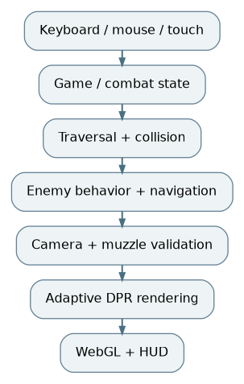

# Pencil Arena: Architecture, Implementation and Engineering Analysis

**ABProjects** · Technical Report · 17 October 2026

**Abstract.** A third-person stickman survival shooter in a hand-drawn 3D world, with enemy waves, procedural encounters, combat, traversal, camera solving and adaptive rendering. This report examines the actual shipped single-file architecture, execution model, engineering trade-offs, targeted improvements and validation limits. Statements about changes are grounded in the code supplied with this release. Performance improvements are presented as structural reductions in eligible work, not unmeasured frame-rate claims.

*Figure 1. Functional system view; all runtime subsystems remain within one self-contained HTML document.*

**Keywords:** HTML5, WebGL, Three.js, browser games, frame scheduling, game engineering, deterministic execution, source preservation.

## 1. Game systems and scope

Pencil Arena is an endless survival shooter in which a stickman fights aggressive erasers in a drawn 3D environment. Its design includes increasing enemy pressure, aiming and weapon handling, ammunition and health management, collision and traversal, score handling and a persistent best result. The implementation contains combat, enemy and navigation controllers as well as presentation systems. The entire game is delivered in a single `index.html` with the Three.js distribution included inline.

## 2. Scene and movement architecture

Three.js renders a three-dimensional arena with a perspective camera, animated player rig, collider geometry and procedural effects. Player locomotion supports context-dependent movement modes including crouch, slide, mantle, window passage and ladder interaction. The render frame resolves camera obstruction and shoulder composition before the weapon pose and firing validation. This ordering matters: the projectile validation should use a muzzle computed from the current camera rather than the previous frame, avoiding inconsistent blocked shots during quick turns. These relationships are already present in the uploaded implementation and were preserved.

## 3. Enemy navigation

The enemy subsystem uses a connectivity graph and a binary min-heap to construct navigation and flow information toward a target. The `Heap` class supports priority-first expansion, and the controller periodically recomputes field information rather than tracing an entirely new high-cost route for every enemy every frame. Enemy decision making is built around distinct modes including searching, investigating and hunting. Navigation, collision handling and tactical behavior are separate computational concerns, even though their source remains in one HTML document. The report describes the code's implementation rather than proposing new behavior or difficulty balancing.

## 4. Frame pacing and adaptive pixel ratio

Rendering cost is controlled in the original source by a dynamic device-pixel-ratio mechanism. `PA_RENDER_MAX_DPR` is bounded by the device DPR and 2; the minimum is device-dependent. The measured frame-time estimate uses exponential smoothing, with thresholds around 23.5 ms for sustained pressure and 15.2 ms for sustained headroom. Resolution changes occur in discretized 0.05-DPR steps and with cooldown/hysteresis, limiting rapid quality oscillations. This is an existing adaptive performance facility, not a newly implemented optimizer.

## 5. Frame loop and targeted optimization

The application requests animation frames continuously and computes a clamped delta from a Three.js clock. When simulation is active it steps locomotion, enemy logic, weapons, character pose and effects. When paused the simulation time is held and gameplay updates stop; the prior build nevertheless submitted a WebGL scene every animation frame. The new conditional skips WebGL draws in hidden tabs and limits paused/menu scene drawing to 10 Hz. On a 60 Hz display, an otherwise idle scene is eligible for at most one sixth as many draws; actual GPU-time savings depend on scene cost and browser throttling. Crucially, the controller and DOM receive their usual animation-frame callbacks, so key and pause responsiveness remains intact.

## 6. Correctness and limitations

Focus loss and tab visibility already clear held keys and pause active combat. The change preserves those input safety mechanisms and does not modify weapon ammunition, damage, enemy speed, scripted wave cadence or camera parameters. The distribution includes advanced debugging hooks under `window.__arena` and supports internal probes, but a reliable automated visual gameplay test requires a working WebGL context. Syntax checks passed; a complete combat/replay and device matrix remains an explicit manual acceptance requirement.

## 7. Navigation and rendering complexity

The enemy navigation subsystem operates over graph nodes representing traversable game locations. Its heap-based priority operations have logarithmic cost in the number of queued candidates; constructing or refreshing a field ordinarily combines graph traversal and edge examination. The practical design choice is to amortize field recomputation across enemies rather than issuing separate full path searches for each entity on every render frame. The code uses cached target/time information to avoid unnecessary full refreshes. The precise performance of navigation depends on the number of enemies, current layout topology and frequency of target changes; it has not been benchmarked in this release.

The adaptive rendering estimator uses the frame-time sample `s = clamp(ms,1,80)` and exponential blend factor `alpha = 1 - exp(-2.1*dt)`:

`ema <- ema + alpha * (s - ema)`.

Sustained average frame times above 23.5 ms accumulate a slow counter; after more than 1.25 seconds and cooldown expiry, device-pixel ratio is lowered by 0.15. Sustained frame times below 15.2 ms accumulate a fast counter; after more than 6 seconds and cooldown expiry, DPR rises by 0.10. The code quantizes updates to 0.05 and uses 2.6 or 4.2 second cooldowns. These asymmetric thresholds make downscaling more responsive than recovery. This behavior predates the current revision, which retains it unchanged.

In the added paused-render governor, the WebGL draw is eligible every 100 ms only while no active simulation occurs. DOM interfaces and animation-frame callbacks continue. Rendering is still full-rate during play, so interactive aiming, hit timing and camera smoothing are unaffected. The function keeps the original frame-start timestamp for the eligibility check rather than invoking another high-resolution timer on each pause frame.

## 8. Correctness boundaries

**Physics/traversal.** The simulation supports overlapping locomotion, collision resolution and animated transitions. A low-risk optimization must avoid altering any of the positional predicates that control crouch, slide, mantle and ladder states. The maintenance release leaves those predicates intact.

**Weapon alignment.** The current implementation intentionally finalizes the camera before upper-body/weapon pose and firing computation, to avoid disagreement between rendered muzzle and shot origin. Moving these calls for superficial readability would reintroduce subtle occlusion and collision errors. The report's architecture diagram records the dependency chain without extracting it into modules.

**Held controls.** Browser blur and tab visibility already clear held input. Paused rendering is throttled but not simulation callbacks or event handling. This minimizes the chance that pressing a resume key remains unnoticed until the next scene draw.

**Adaptive quality versus idle frames.** Paused render cost is not fed into a new performance threshold. The existing `paUpdateAdaptiveRenderScale` only responds when active simulation is permitted, preventing low idle draw rate from tricking the quality estimator into downscaling or upscaling.

## 9. Evaluation protocol

A useful real-browser evaluation would capture 30 seconds in three conditions: idle menu, paused gameplay and a fixed seeded wave at stable camera resolution. Compare GPU rendering passes, frame-time percentiles (P50/P95/P99), active-enemy count and memory allocation against the original release on the same hardware. Exercise the authored `window.__arena` diagnostic probes to inspect player position, weapon state, active pose, render DPR and solver timings. Then perform a traversal matrix: stairs, window vaults, roof edges, narrow doorways, low passages, scoped shooting and shoulder switching. This release provides the test checklist but no invented timing measurements.

## Controlled browser observations

Under an Xvfb/SwiftShader Chromium session, both builds created a 1280×720 WebGL canvas, displayed the splash, and reached the main menu without uncaught JavaScript errors. The patched build's `window.__arena.probe()` returned a grounded initial player, no collision fallbacks, and a valid eight-route access check. In an isolated test that stubbed `renderer.render`, the baseline made **65** idle render requests and the revised build made **18** over a roughly 3.6-second observation. These are scheduler counts, not measurements of rendered frames or FPS on GPU hardware.

## 10. Build structure and release integrity

The playable deliverable remains **`index.html`**. No source was split into imports, ES modules, bundles or fetched runtime resources. Documentation, diagnostics and GitHub publishing helpers are external to the playable game; they are not runtime dependencies. Original and updated SHA-256 values are recorded in `docs/RELEASE_MANIFEST.json`. The applied behavior changes are intentionally isolated and documented in `docs/RELEASE_NOTES.md`.

The included `tests/verify.mjs` checks that the repository contains a self-contained HTML document, runs JavaScript syntax validation, and confirms that the expected safety/performance markers are present. It is a smoke check, not a substitute for end-to-end playtesting on real graphics hardware.

## 11. Verification status

**Completed:** source inspection; successful parsing of every inline script using Node.js; HTML structural check; traceable, limited source patches; independent archive integrity checks. **Not completed:** GPU-accelerated frame benchmarks, exhaustive input-device testing, multiplayer/network testing (not applicable), long-run performance sampling, and full in-game visual regression. Initial headless Chromium could not initialize WebGL, but a virtual-desktop Chromium instance using SwiftShader subsequently loaded the game. Startup/menu smoke checks succeeded without uncaught JavaScript exceptions. No exhaustive game-playthrough, cross-browser matrix or GPU performance benchmark was performed.

## 12. Deployment and third-party notices

The playable build is distributed as one `index.html`. Local testing can be performed by opening it in a desktop browser; if browser security policies restrict a feature, serve the same file from a local HTTP server. Publishing to itch.io as an HTML5 game requires placing `index.html` at the root of the uploaded ZIP. See [the game's itch.io listing](https://abprojects.itch.io/pencil-arena) for the existing public game page and any project imagery. Repository screenshots must be captured or downloaded and checked for permission before embedding; this release does not invent gameplay imagery.

The file contains embedded third-party engine/runtime code and licenses/attribution already carried inside its source. A public GitHub repository does **not** grant additional reuse rights by itself. No new overarching licence has been selected on the author's behalf.

## References

1. ABProjects, [Pencil Arena on itch.io](https://abprojects.itch.io/pencil-arena), live project listing.
2. ABProjects, `index.html`, source release analyzed for this report.
3. Three.js, WebGL rendering library, embedded release code and notices.
4. ABProjects, `docs/RELEASE_MANIFEST.json` and `tests/verify.mjs`, release verification evidence.
